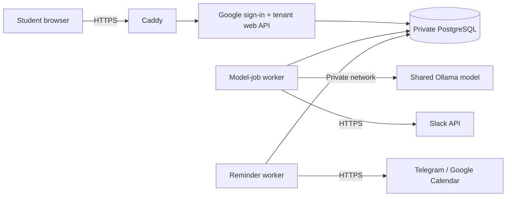

# Pilot deployment

These files prepare an always-on deployment; no hosting account, paid resource, DNS change, or production deployment has been created. Docker is not installed in the development environment. Local validation covers source structure and configuration syntax; a real Linux host must still build and start the containers, validate Caddy, exercise Google/Slack redirects, and complete the restore drill before students join.

## Recommended first topology

Use one always-on Linux VM with Docker Engine and Compose v2 for Caddy, the Node 24 web process, a model-job worker, a separate reminder worker, and PostgreSQL 17. Start with **4 vCPU / 8 GB RAM** as an unmeasured planning allocation. Keep one tested open-weight model on a second always-on GPU host, reachable only through a private VPC or a WireGuard tunnel with a private address such as `10.77.0.2`. Model/GPU memory needs depend on quantization, prompt length, and concurrency; verify the chosen model fits before renting capacity. Neither a sleeping laptop nor a static website host provides this backend.



Only Caddy publishes ports 80/443. PostgreSQL has no host port; web and both workers use different unprivileged credentials. Each app container runs nonroot with a read-only filesystem and a bounded temporary filesystem. Persistent PostgreSQL and certificate volumes are intentional exceptions. Runtime resource limits are initial protection against runaway work, not evidence of supported student capacity.

n8n is optional operator automation. The application database, access checks, queue, and reminder processes own student-facing behavior. If added later, host n8n behind a private operator VPN with separate credentials and execution-data retention; do not expose its editor or give students the shared n8n account. It is not part of this deployment.

## Information needed before launch

- A hosting account/VM target, approved monthly spend, domain you control, and an operator who receives alerts.
- A Google OAuth **web application**, Calendar API enabled, consent screen/test-user setup, and redirect `https://YOUR_DOMAIN/auth/google/callback`. Use the same authorized origin as `APP_ORIGIN`. Cornell may need to approve the app/scopes. Each student authorizes their own account; nobody shares Cornell passwords.
- A **rotated** token for the shared Telegram bot, stored through the host secret mechanism. The token previously pasted into conversation must be revoked. Students start the same bot with an expiring link code; they do not create bots.
- For Slack: an approved OAuth app, client ID/secret, Cornell workspace ID in `SLACK_ALLOWED_TEAM_IDS`, and redirect `https://YOUR_DOMAIN/auth/slack/callback`. The requested user scopes read channel membership/history; the app limits fetching to the student’s selected channel. Workspace administrator approval may be needed. No Slack signing secret is needed for the polling design.
- A private, always-on model host and tested model name. No model API is published to the internet.
- The exact invited student email list, operator email list, backup destination, backup key custodian, retention policy, and pilot privacy notice.

CampusGroups automatic SSO access and real employer submissions remain separate integration work. An authenticated calendar export is usable now. Do not collect Cornell SSO passwords or promise automated CampusGroups discovery from an unauthenticated endpoint.

## Local development

The local `.env` is mode 0600 and ignored by source control. It points to `dabas_local_pilot` on a separate, password-protected PostgreSQL cluster in `data/postgres-local`, listening only on `127.0.0.1:55439`. Host and socket connections require SCRAM; the socket directory is mode 0700. Web and worker logins are different, unprivileged roles. The prior single-student SQLite data is preserved separately. The test cluster on port 55438 is for synthetic data only; it must not host real student records.

Local sign-in is deliberately opt-in: set `DEV_AUTH_EMAILS` to the exact allowed Cornell address, `HOST=127.0.0.1`, `APP_ORIGIN=http://127.0.0.1:4318`, and `NODE_ENV=development`. A request cannot invent another student email. This mode is rejected in production and must never be enabled on a public domain. Real deployment uses Google verification and the pilot allowlist. The local migration owner credential is separate in ignored `data/local-pilot-owner.env`; never load it into the running web or worker process.

The local database copy was compared table-by-table and all student records were decrypted through the unprivileged web role before the connection URLs changed. A mode-0600 migration backup exists at `data/local-pilot-pre-scram.dump.enc`: it is a JSON envelope containing AES-256-GCM `iv`, `tag`, and `ciphertext` fields encoded as base64, using the 32-byte `DATA_ENCRYPTION_KEY` from `.env`. Decrypting it yields a PostgreSQL custom-format dump. Keep that key with the private recovery package. This local recovery artifact is separate from the production `age` backup procedure below. Verify the new cluster before removing any original copy; do not delete the legacy SQLite data as part of the migration.

## Configure and start

Run from the project root on the chosen host. Keep `deploy/pilot.env` and `deploy/secrets/` out of source control and backups that are not encrypted. Do not copy local `data/`, `.env`, resume PDFs, or demo exports into the deployment image; the Docker build uses an allowlist.

```sh
cp deploy/pilot.env.example deploy/pilot.env
node deploy/init-secrets.mjs
```

Edit `deploy/pilot.env` with the real domain, OAuth client ID, invited emails, model address/name, and current monthly infrastructure estimate. Set `ADMIN_EMAILS` to the minimal operator list; operators must also be invited. Set `MONTHLY_INFRA_COST_USD` to a current budget estimate; leave it blank while unknown. Zero is not evidence of zero cost. Write `deploy/secrets/google_client_secret` using an editor/secret manager; fill the optional `telegram_bot_token` and `slack_client_secret` files when those connectors are ready. Keep the secret directory mode **0700** and secret files mode **0444**: Compose bind mounts retain host ownership, so distinct container UIDs must be able to read only the files explicitly granted to their service. Host users cannot traverse the private parent directory. Docker administrators and host root can access these secrets.

Resolve current, patched image digests with `docker buildx imagetools inspect IMAGE:TAG`, review them, then put the complete `name:tag@sha256:…` references in `NODE_IMAGE`, `CADDY_IMAGE`, and `POSTGRES_IMAGE`. This is mandatory in the production check. Keep these digests updated through tested releases. Build on the target architecture.

For `NODE_IMAGE`, use an official Node 24 **trixie-slim** tag and its tested digest, for example `node:24-trixie-slim@sha256:…`. Replace any earlier bookworm-slim override when upgrading. Trixie supplies Python 3.13; the pinned MarkItDown dependency set requires Python >=3.11.5,<3.15 and deliberately excludes older vulnerable dependency resolutions. The image build checks this version range before installation and verifies the converter as the nonroot runtime user. CI audits the exact installed Python packages and converts a synthetic PDF with the image's network disabled and filesystem read-only.

```sh
node scripts/check-deployment.mjs --production
docker compose --env-file deploy/pilot.env -f compose.pilot.yml build
docker compose --env-file deploy/pilot.env -f compose.pilot.yml up -d postgres
docker compose --env-file deploy/pilot.env -f compose.pilot.yml --profile ops run --rm migrate
docker compose --env-file deploy/pilot.env -f compose.pilot.yml up -d web worker reminders discovery proxy
docker compose --env-file deploy/pilot.env -f compose.pilot.yml ps
```

Set DNS to the host before Caddy starts. The host firewall/security group permits public 80/443; SSH is restricted to the operator VPN/addresses. No public 4318, 5432, 5678, or 11434. WireGuard/VPC ACLs permit model port 11434 only from the app host. Where available, use encrypted host volumes, automatic security patches, MFA on hosting/DNS/GitHub accounts, and no password SSH. Docker port publishing can bypass host firewall expectations; verify from a second machine that only the intended ports are reachable.

The app image entrypoint translates mounted secrets into the existing application environment variables without printing them. `DATABASE_URL` is assembled for the appropriate service; `WORKER_DATABASE_URL` is available only in workers; `MIGRATION_DATABASE_URL` exists only in the one-off migrator. Application secrets are not magically inaccessible to a privileged host operator. Ordinary Compose file secrets are bind mounts, not an encrypted secret vault. [Docker’s secret documentation](https://docs.docker.com/compose/how-tos/use-secrets/) describes this mechanism.

For a later managed/external PostgreSQL deployment, use a verified TLS connection with `sslmode=verify-full`, and the provider’s CA through `sslrootcert` where required. The adapter rejects weak external TLS modes and imposes 30-second statement and 10-second lock deadlines. Do not use `rejectUnauthorized=false` or disable Node TLS verification. The in-host Docker database uses its private container network; moving it to another network requires a fresh network/TLS review.

The model-host systemd example in this folder starts with one loaded model and one inference request at a time. Install and update Ollama using its supported host instructions, pull only the model selected by the operator, and apply the private interface/firewall controls before enabling it. Increasing parallel inference consumes additional model memory; measure before changing it. [Ollama concurrency documentation](https://docs.ollama.com/faq).

## Monitoring and first-student gate

Use an external uptime monitor for `https://YOUR_DOMAIN/healthz` every minute; the host cannot reliably report its own outage. The endpoint excludes prompts, credentials, model inventory, and student data. A healthy web process does not establish model or reminder health.

An operator signed in through normal Google authentication can read `/api/operations` if listed in `ADMIN_EMAILS`. It reports 30-day active students, queue totals/delays, model latency, reminder outcomes/lateness, worker heartbeat ages, and an estimated cost per active student. It must never be exposed as an anonymous metrics endpoint. Docker health status for worker containers uses the heartbeat file; Docker Compose does **not** automatically restart a merely unhealthy container. Use an external monitor/operator alert; `restart: unless-stopped` handles exited processes.

Initial alert targets (not measured results): heartbeat older than 120 seconds; failed/uncertain reminders above zero; reminder p95 lateness over 60 seconds; oldest model job above 120 seconds; repeated provider failure; free disk below 20%; backup age over 24 hours. Observe a baseline before adjusting thresholds. Caddy request access logs are disabled to avoid storing OAuth codes and identifiers. Keep operational logs content-free; never enable prompt/token/request-body logging for debugging real students.

Before admitting students, verify two independent accounts cannot access one another’s documents, connectors, queue records, or export/delete actions; restore an encrypted backup into an isolated database; simulate a worker crash and model timeout while reminders continue; test Google/Slack revocation; verify CSRF rejection and session logout; run a small capacity trial in staging. Record results and remaining gaps. CI and static configuration checks are useful evidence, not a penetration test or availability guarantee.

## Backups, restore, and updates

Use an `age` encryption public recipient whose private key is stored offline, separately from the host. Run `deploy/backup.sh` daily through the operator scheduler with `BACKUP_AGE_RECIPIENT` configured. It streams a privileged PostgreSQL custom-format dump directly into encryption without a plaintext dump on disk. Copy the resulting `.dump.age` file to a separate access-controlled storage account/bucket and verify transfer success. Configure age-based expiry there and in the local backup directory; the script deliberately does not invent a retention period or delete backups automatically. Back up the data-encryption key and configuration separately under encryption; losing the key makes encrypted database records unrecoverable. [PostgreSQL dump/restore documentation](https://www.postgresql.org/docs/current/backup-dump.html).

Proposed first-pilot objectives are RPO ≤24 hours and RTO ≤4 hours; they remain targets until the restore drill proves them. A daily dump cannot satisfy a tighter RPO; adopt managed PostgreSQL point-in-time recovery or WAL archiving when that is required.

Restore procedure: use a **separate, disposable host/Compose project** with no public ingress, no model/reminder services, and no Telegram/Google/Slack credentials. Provision its roles with `postgres-init.sh`, restore the original `DATA_ENCRYPTION_KEY` from the offline recovery package, and restore the database dump as the migration owner. Never test restore over the live database. On the isolated host, a database administrator can run this with the backup/private-key paths substituted:

```sh
set -o pipefail
age --decrypt --identity /secure/offline-age-key /secure/backup.dump.age |
  docker compose --env-file deploy/pilot.env -f compose.pilot.yml exec -T --user postgres postgres \
  pg_restore --username postgres --dbname dabas --role dabas_owner --no-owner --exit-on-error
```

The target database must be empty. Bootstrap creates the database/roles; **do not run migrations before restoring the complete dump**. Confirm table counts, student isolation, decryption, queue states, and backup timestamp. A restored old queue can contain previously transmitted work: keep workers stopped until historical reminders and uncertain application/notification actions are reconciled. Record elapsed restore time and data age, then dispose of the test database and recovery artifacts according to the approved policy.

For an update, record the current image digests, take a verified encrypted backup, stop queue consumers, run migrations once with the owner credential, then deploy the tested application image and workers. Prefer additive schema migrations that work with the prior version. A compatible application change can roll back to its prior image. No destructive automatic down-migration is supplied: an incompatible schema rollback requires maintenance mode and a tested restore/cutover plan, including reconciliation of actions sent since the backup. Replacing password files does not alter roles in an existing PostgreSQL volume; rotate the database role password and corresponding mounted secret together, then restart affected services.

## Privacy and security limits

Student ownership and PostgreSQL RLS protect against accidental tenant mixups and many application authorization errors. App workers remain trusted service processes; a compromised host/database administrator or arbitrary code execution in a privileged service can bypass application boundaries. Per-record encryption at rest does not prevent that. Strict defense against malicious privileged operators would need a different key-management/trust model.

The database receives the authenticated student ID through transaction-local context. Because students share a service login, RLS does not isolate arbitrary SQL executed by a compromised app that can deliberately select another tenant context. It is an additional guard alongside request authorization and parameterized queries. The runtime role cannot disable policies or use a superuser/bypass role; migration and worker capabilities use separate credentials.

Queue claims and completions are fenced by lease tokens, with bounded retries and separate model/reminder worker types. A lease is not an external-provider transaction and cannot retract a message already sent. A worker that loses its lease can also continue an in-flight inference until timeout; fencing queue completion alone does not prove that all intermediate writes or physical GPU work stop immediately. Unsafe transmission outcomes go to review instead of blind retries. Keep one reminder scheduler for the initial pilot and exercise restart/partition cases before adding replicas or claiming exactly-once delivery.

The system necessarily stores more than a resume and schedule: identity/session state, encrypted connector credentials, consent/preferences, queued jobs, source evidence, application drafts, delivery state, and operational timestamps. This supports isolation, retries, and deletion. Document exact retention and backup expiry before onboarding. Disconnecting the app does not remove previously created Google events, received Telegram messages, Slack originals, or employer-held applications.

Queue payloads/results have a default 24-hour expiry and are removed by worker claim maintenance once no longer running; an outage delays physical cleanup, while expired jobs cannot be retried as fresh work. OAuth state expires after 10 minutes and sessions after 8 hours; a bounded maintenance pass removes expired records over time. The application’s student activity history is capped at 150 entries. Resume/source/application records, separate model metrics, and reminder history persist until account deletion unless a further retention policy is configured. Backup expiry remains an operator policy, not an implemented promise of immediate erasure.

Account deletion is permanent for that pilot identity: an atomic database operation removes student records/jobs, then retains a minimal tenant-ID/deletion-time tombstone to block delayed work from recreating content. Authentication revocation markers may remain; expired session/OAuth rows are swept separately. Normal sign-in cannot recreate a deleted pilot account. Re-enrollment requires an operator-reviewed design; do not erase tombstones casually. Explain this behavior and the backup expiry period in onboarding before accepting real student accounts.

Use synthetic accounts/data for load and security tests. The application includes consent and approval boundaries for calendar writes and submissions; local draft preparation does not establish that arbitrary employer applications can be safely or accurately submitted. Refresh dependency/container vulnerabilities and review scope before expanding the pilot. Caddy automatically provisions/renews certificates once domain and network prerequisites are satisfied. [Caddy HTTPS documentation](https://caddyserver.com/docs/automatic-https).
